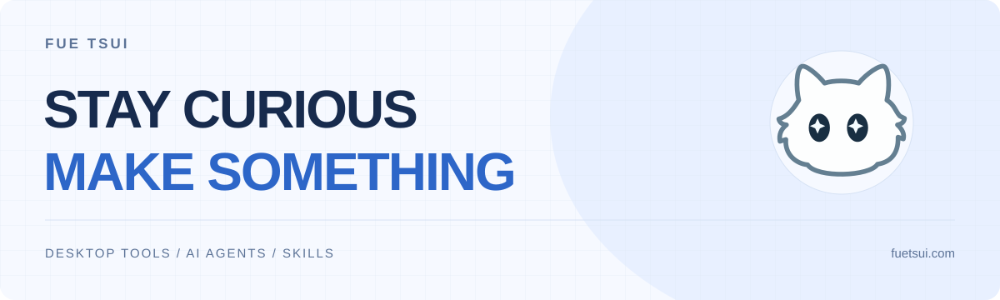

<picture>
  <source media="(prefers-color-scheme: dark)" srcset="assets/header-dark.svg">
  <source media="(prefers-color-scheme: light)" srcset="assets/header-light.svg">
  
</picture>

## 从日常问题出发，做顺手的工具。

你好，我是 **Fue Tsui**，一名 AI 独立开发者。主要做桌面应用、AI Agent 和可复用技能，也喜欢探索设计与交互。

我关心一个工具能不能真正融入日常：少一点重复操作，清楚一点的界面，把事情做完整。

[个人网站 ↗](https://fuetsui.com) · [技能工坊 ↗](https://ai.fuetsui.com) · [Email ↗](mailto:fuetsui@163.com)

### 桌面工具

| 项目 | 用来做什么 | 构建方式 |
| :--- | :--- | :--- |
| **[SightOCR](https://github.com/FueTsui/SightOCR)** | 截图、识别、翻译，把屏幕上的文字变成可编辑内容。 | Rust · egui · Win32 |
| **[Cloudlet](https://github.com/FueTsui/Cloudlet)** | 连接云存储，管理挂载、文件与传输任务。 | C# · WinUI 3 · rclone |
| **[FloatCountdown](https://github.com/FueTsui/float-countdown)** | 悬浮倒计时，让演示、授课和分环节计时更从容。 | Rust · Tauri |

### AI 与可复用技能

- **[HarnessAgent](https://github.com/FueTsui/HarnessAgent)** — 一个连接模型、工具、Skills 与知识库的智能体平台，探索从对话到任务完成的过程。
- **[个人技能工坊](https://github.com/FueTsui/personal-skill-builder)** — 通过一问一答，把工作经验和重复任务整理成可复用的 AI 技能。
- **[PPTX Skill](https://github.com/FueTsui/pptx)** — 从材料出发，生成带原生可编辑文字的 PowerPoint 与离线 HTML 演示稿。

### 我在探索

- **AI 如何进入实际工作**：让工具调用、任务执行和结果验证连起来。
- **经验如何被复用**：把做过一次的流程，整理成下次还能使用的技能。
- **工具如何更顺手**：从界面、交互到安装与更新，打磨完整的使用体验。

欢迎在对应项目的 Issue 中反馈使用体验，或[发邮件](mailto:fuetsui@163.com)交流想法。

---

Small tools. Useful every day. · [浏览全部项目 ↗](https://github.com/FueTsui?tab=repositories)
