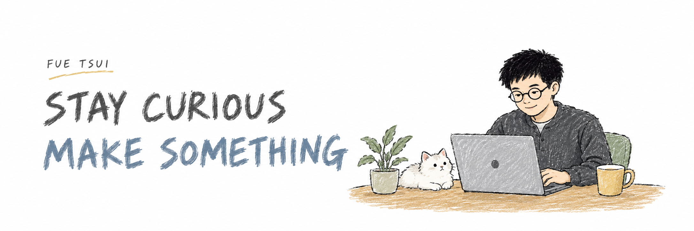

## 从日常问题出发，做顺手的工具。

你好，我是 **Fue Tsui**，一名 AI 独立开发者。主要做桌面应用、AI Agent 和可复用技能，也喜欢探索设计与交互。

我关心一个工具能不能真正融入日常：少一点重复操作，清楚一点的界面，把事情做完整。

[个人网站 ↗](https://fuetsui.com) · [技能工坊 ↗](https://ai.fuetsui.com) · [Email ↗](mailto:fuetsui@163.com)

### 我在探索

- **AI 如何进入实际工作**：让工具调用、任务执行和结果验证连起来。
- **经验如何被复用**：把做过一次的流程，整理成下次还能使用的技能。
- **工具如何更顺手**：从界面、交互到安装与更新，打磨完整的使用体验。

欢迎在对应项目的 Issue 中反馈使用体验，或[发邮件](mailto:fuetsui@163.com)交流想法。

---

Small tools. Useful every day. · [浏览全部项目 ↗](https://github.com/FueTsui?tab=repositories)
